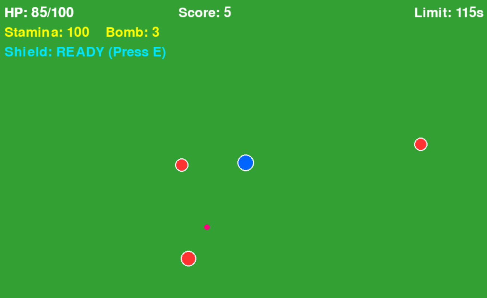

# SURVIVAL ARENA

## 実行環境の必要条件

* python >= 3.10
* pygame >= 2.1

## ゲームの概要

* 画面中央のプレイヤー（青色の丸）を操作し，四方から次々と出現して追いかけてくる敵（赤色の丸）から逃げ続ける2D見下ろし型サバイバルゲーム。
* 制限時間120秒間，敵との接触を避けながら生き残ることを目指す。

## ゲームの遊び方

* W / A / S / D キーでプレイヤーキャラクターを上下左右に移動させる。
* SHIFT キーを押すと，一時的に移動速度が上昇する（ダッシュ機能）。
* SPACE キーを押すと，画面内にいる敵を一括で排除する（爆弾機能）。
* E キーを押すと，一定時間敵からのダメージを無効化する（シールド機能）。
* フィールド上に出現するアイテムを取得すると，HPの回復やスコアの加算ができる。
* R キーでゲームオーバーまたはクリア画面からゲームをリスタートする。
* ESC キーでゲームを終了する。

## ゲームの実装

### 共通基本機能

* 背景およびプレイヤー，敵キャラクターの描画
* WASDキーによるプレイヤーの移動制御（斜め移動の速度正規化および画面外への移動制限）
* 画面外からの敵のランダム生成およびプレイヤー追尾処理
* プレイヤーと敵の当たり判定（接触時のHP減少処理および無敵時間・点滅制御）
* 画面上部へのHP，生存時間（スコア），残り時間の表示
* HPが0になった際のGAME OVER表示，120秒間生存した際のCLEAR表示
* リスタートおよびゲーム終了機能

### 分担追加機能

* ダッシュ機能（担当：泉）：SHIFTキー押下時にプレイヤーの移動速度を一時的に上昇させる機能
* 爆弾機能（担当：有坂）：SPACEキー押下時に画面内の敵を一括で排除する機能
* シールド機能（担当：山本）：Eキー押下時に一定時間敵からのダメージを無効化するバリアを展開する機能
* アイテム機能（担当：木村）：フィールド上に回復アイテムやスコア加算アイテムを出現させ，プレイヤーが取得できる機能
* 特殊な敵の追加（担当：忠）：通常の敵とは異なる速度や移動パターンを持つ新しい種類の敵を追加する機能

### メモ

* コードは `main.py` の単一ファイル構成とし，`Player`，`Enemy`，`Game` の各クラスを用いたオブジェクト指向設計としている。
* 実行時の作業ディレクトリを固定するため，スクリプトの先頭に `os.chdir(os.path.dirname(os.path.abspath(__file__)))` を記述している。
* 各クラスおよび関数には型ヒント（Type Hints）とdocstringを記述し，処理内容を分かりやすくするとともに，メンバーごとの機能追加や修正を行いやすい設計としている。